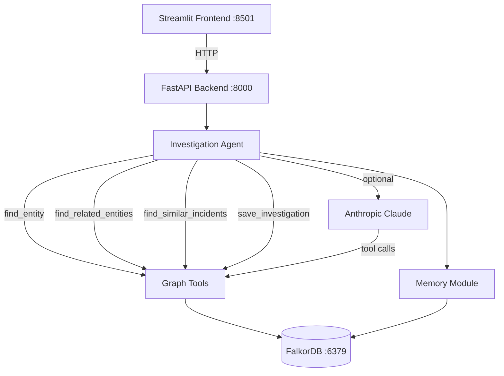

# MASTER_DOCUMENTATION.md
# GraphGuard — Complete Technical Reference

---

## Section 1: Project Overview

**GraphGuard** is an AI-powered security incident investigation assistant that uses **FalkorDB** as its persistent graph-based context layer.

### Problem Solved
Traditional AI agents lose context between sessions, inspect individual records without following relationships, and provide conclusions without traceable evidence. GraphGuard solves this by:
- Storing all security entities and relationships in a knowledge graph
- Following multi-hop connections (Alert → Device → Incident → Evidence) to discover hidden risk
- Persisting investigation memory across sessions in FalkorDB
- Providing evidence-backed reports with graph path citations

### Hackathon Tracks
- **Primary: Track 01** — Agents That Act on Connected Data
- **Secondary: Track 02** — Agent Memory and Coordination

### Why FalkorDB is Essential
FalkorDB is not used merely as a key-value store. It actively shapes agent behavior:
- The agent's tool results come from real Cypher queries
- Investigation scope is determined by what relationships actually exist in the graph
- Historical memory is retrieved via graph traversal, not keyword search
- Missing relationship (Scenario B) causes measurably different agent conclusions

### Capabilities
- **Can do**: Investigate synthetic alerts, follow 3-hop graph paths, retrieve historical investigations, explain reasoning, persist findings
- **Cannot do**: Connect to real SIEM/EDR, authenticate users, run in production, use OpenAI (Anthropic only in MVP)

---

## Section 2: Features

| Feature | Status |
|---|---|
| FalkorDB connection with health check | ✅ Implemented and verified |
| Deterministic seed (3 scenarios, idempotent) | ✅ Implemented |
| `find_entity` graph tool | ✅ Implemented |
| `find_related_entities` (bounded multi-hop) | ✅ Implemented |
| `find_similar_incidents` via shared entities | ✅ Implemented |
| `save_investigation` (MERGE upsert) | ✅ Implemented |
| Persistent investigation memory retrieval | ✅ Implemented |
| Demo mode (deterministic, no LLM) | ✅ Implemented |
| Anthropic tool-calling LLM mode | ✅ Implemented |
| FastAPI REST endpoints | ✅ Implemented |
| Streamlit dark security-ops UI | ✅ Implemented |
| Plotly graph visualization | ✅ Implemented |
| Unit tests (no DB) | ✅ Implemented |
| Integration tests (DB required) | ✅ Implemented |
| Tenant isolation | ✅ Implemented (find_entity with tenant filter) |
| Evidence validation | ✅ Heuristic (graph path cited in findings) |
| OpenAI provider | ⏳ Planned |
| Graph-dependent decision automated test | ⏳ Pending verification |
| MCP adapter | 📋 Future |

---

## Section 3: Architecture



### Component Roles
- **Streamlit**: Dark security-ops UI; sends HTTP requests to FastAPI; renders investigation reports, graph explorer, history
- **FastAPI**: Validates input; routes to agent or graph tools; returns Pydantic-validated responses
- **Investigation Agent**: Orchestrates tool calls; builds evidence-backed reports; routes to demo or LLM mode
- **Graph Tools**: Four pure Python functions each executing real Cypher queries against FalkorDB
- **Memory Module**: Retrieves historically related investigations from FalkorDB by alert and entity overlap
- **FalkorDB**: Single source of truth for all entities, relationships, and persisted investigations
- **LLM (Anthropic)**: Optional; receives tool definitions; calls graph tools via API; bounded to 8 calls

---

## Section 4: Project File Map

```
graphguard/
├── backend/
│   ├── __init__.py         # Package marker
│   ├── config.py           # Pydantic settings (env vars)
│   ├── graph_db.py         # FalkorDB connection + health check
│   ├── graph_tools.py      # 4 graph tools + helper queries
│   ├── agent.py            # Investigation agent (demo + LLM)
│   ├── memory.py           # Persistent memory retrieval
│   ├── schemas.py          # Pydantic request/response models
│   ├── seed.py             # Deterministic synthetic data
│   └── main.py             # FastAPI application
├── frontend/
│   └── app.py              # Streamlit dashboard (4 pages)
├── tests/
│   ├── __init__.py
│   ├── test_graph_tools.py # Integration tests (DB required)
│   ├── test_agent.py       # Unit tests (mocked, no DB)
│   ├── test_api.py         # API endpoint tests (mocked)
│   └── test_memory.py      # Cross-session memory test (DB required)
├── .env.example            # Environment variable template
├── .gitignore
├── docker-compose.yml      # FalkorDB container
├── requirements.txt
├── README.md
├── MASTER_DOCUMENTATION.md # (this file)
├── PROJECT_STATUS.md       # Current state + verified commands
└── TASKS.md                # Task tracker
```

### Detailed File Descriptions

#### `backend/config.py`
- **Purpose**: Central settings, read from environment / `.env` file
- **Key class**: `Settings(BaseSettings)` — all env vars with defaults
- **Key property**: `is_llm_enabled` — True when API key set and provider != "demo"
- **Dependents**: All backend modules import `settings` from here

#### `backend/graph_db.py`
- **Purpose**: Manages FalkorDB connection lifecycle
- **Key functions**: `get_db()`, `get_graph()`, `health_check()`, `reset_connection()`
- **Pattern**: Lazy singleton — connection created on first use
- **Change if**: FalkorDB host/auth config changes

#### `backend/graph_tools.py`
- **Purpose**: All Cypher queries; the agent's tool functions
- **Key functions**:
  - `find_entity(entity_id, tenant_id)` — MATCH node by entity_id
  - `find_related_entities(entity_id, ...)` — variable-length path traversal
  - `find_similar_incidents(entity_ids, ...)` — incident retrieval via shared entities
  - `save_investigation(...)` — MERGE upsert for Investigation + Finding nodes
  - `get_graph_stats()` — count nodes by label
  - `get_recent_investigations(...)` — list investigations from DB
  - `get_entity_neighbors(...)` — direct neighbor lookup for UI
- **Change if**: Adding new node types or relationships; modifying query logic

#### `backend/agent.py`
- **Purpose**: Investigation orchestration
- **Key functions**:
  - `run_investigation(...)` — public entry point; routes to demo or LLM; always persists
  - `_demo_investigate(...)` — deterministic 4-step workflow using real graph tools
  - `_llm_investigate_anthropic(...)` — bounded tool-calling loop (max 8 calls)
  - `_compute_risk(...)` — heuristic risk score (documented as heuristic)
  - `_risk_level(score)` — score → critical/high/medium/low/unknown
  - `_dispatch_tool(name, inputs)` — maps LLM tool name to Python function
- **Change if**: Adding new tools; adding OpenAI; modifying investigation workflow

#### `backend/memory.py`
- **Purpose**: Retrieve historical investigations from FalkorDB
- **Key function**: `get_related_investigations(alert_id, entity_ids, tenant_id)` — searches by same alert ID and shared entity IDs in findings
- **Change if**: Adding new memory retrieval strategies

#### `backend/schemas.py`
- **Purpose**: All Pydantic models for API validation
- **Key models**: `InvestigationRequest`, `InvestigationReport`, `Finding`, `GraphStatsResponse`, `InvestigationSummary`
- **Change if**: Adding new API fields

#### `backend/seed.py`
- **Purpose**: Load synthetic test data into FalkorDB
- **Functions**: `seed(graph)` — MERGE-based idempotent load; `reset_and_seed(graph)` — DELETE all then seed
- **Data**: 10 users, 12 devices, 10 IPs, 6 services, 20 evidence, 6 incidents, 12 alerts
- **Change if**: Adding new demo scenarios or node types

#### `backend/main.py`
- **Purpose**: FastAPI application with all endpoints
- **Endpoints**: /health, /api/graph/stats, /api/graph/entity/{id}, /api/graph/entity/{id}/neighbors, POST/GET /api/investigations, GET /api/investigations/{id}, POST /api/seed
- **Change if**: Adding new endpoints

#### `frontend/app.py`
- **Purpose**: Streamlit dashboard with dark security-ops design
- **Pages**: Dashboard (metrics), Investigate (run + report), Graph Explorer (Plotly network), History (past investigations)
- **Change if**: UI changes, adding new pages

---

## Section 5: Graph Database Schema

### Node Labels and Properties

| Label | Key Properties | Description |
|---|---|---|
| `User` | entity_id, email, name, role, tenant_id | Internal users |
| `Device` | entity_id, hostname, os, owner, tenant_id | Workstations, servers, mobiles |
| `IPAddress` | entity_id, address, ip_type (internal/external), location | IP address records |
| `Alert` | entity_id, name, severity, alert_type, device_id, user_id, status, tenant_id | Security alerts |
| `Incident` | entity_id, name, description, status (confirmed/suspected), confidence, tenant_id | Historical incidents |
| `Evidence` | entity_id, evidence_type, description, status, tenant_id | Log records, DLP events |
| `Service` | entity_id, name, service_type, sensitivity (critical/sensitive/standard) | Internal services |
| `Investigation` | entity_id, session_id, tenant_id, alert_id, risk_level, risk_score, summary, timestamp, mode | Persisted investigations |
| `Finding` | entity_id, statement, finding_type, confidence, verification_status, evidence_ids, entity_ids | Investigation findings |

### Relationships

| Relationship | Direction | Meaning |
|---|---|---|
| `USED` | (User)→(Device) | User used this device |
| `CONNECTED_FROM` | (Device)→(IPAddress) | Device connected from this IP |
| `TRIGGERED` | (User)→(Alert) | User's activity triggered alert |
| `INVOLVED_IN` | (Device)→(Alert/Incident) | Device was involved |
| `ASSOCIATED_WITH` | (Alert)→(Incident) | Alert is associated with historical incident |
| `SUPPORTED_BY` | (Alert/Incident)→(Evidence) | Supported by this evidence record |
| `ACCESSED` | (User)→(Service) | User accessed this service |
| `TARGETED` | (Incident)→(Service) | Incident targeted this service |
| `EXAMINED` | (Investigation)→(Alert) | Investigation examined this alert |
| `DISCOVERED` | (Investigation)→(Finding) | Investigation discovered this finding |
| `RELATED_TO` | (Alert)→(Alert) | Alerts are related |

### Key Multi-Hop Queries (Plain English)

**Scenario A path** (3 hops):
`alert_001 → dev_w005 (INVOLVED_IN) → inc_001 (INVOLVED_IN) → ev_003 (SUPPORTED_BY)`
"The TOR alert is connected to a device that was involved in a confirmed credential theft incident with supporting Mimikatz evidence."

**Tenant filter pattern**:
All queries that accept `tenant_id` add `WHERE n.tenant_id = $tid` to ensure data isolation.

---

## Section 6: Installation Prerequisites

- **Python**: 3.11+ (tested on 3.13.9)
- **Docker**: Docker Desktop with Docker Compose V2
- **Packages**: See requirements.txt (falkordb, fastapi, streamlit, anthropic, plotly, etc.)
- **LLM**: Anthropic API key (optional — demo mode works without)
- **OS**: Windows PowerShell / macOS / Linux

---

## Section 7: Exact Setup Instructions

```powershell
# 1. Open terminal in graphguard/ directory

# 2. Create virtual environment
python -m venv .venv

# 3. Activate (Windows PowerShell)
.venv\Scripts\Activate.ps1
# macOS/Linux: source .venv/bin/activate

# 4. Install dependencies
pip install -r requirements.txt

# 5. Create .env
copy .env.example .env
# Edit .env: set LLM_API_KEY if using LLM mode

# 6. Start FalkorDB
docker compose up -d

# 7. Verify DB (should print PONG)
docker exec graphguard-falkordb redis-cli ping

# 8. Seed the graph
python -m backend.seed

# 9. Start FastAPI
uvicorn backend.main:app --reload --port 8000

# 10. Start Streamlit (new terminal, activate .venv first)
streamlit run frontend/app.py

# 11. Open browser
#   Frontend: http://localhost:8501
#   API docs: http://localhost:8000/docs
```

---

## Section 8: Environment Variables

| Variable | Purpose | Default | Required | Used In |
|---|---|---|---|---|
| `FALKORDB_HOST` | FalkorDB hostname | `localhost` | No | graph_db.py |
| `FALKORDB_PORT` | FalkorDB port | `6379` | No | graph_db.py |
| `FALKORDB_PASSWORD` | FalkorDB password | `` | No | graph_db.py |
| `FALKORDB_GRAPH` | Graph name | `graphguard` | No | graph_db.py |
| `LLM_PROVIDER` | `anthropic`, `openai`, or `demo` | `demo` | No | agent.py |
| `LLM_API_KEY` | LLM provider API key | `` | For LLM mode | agent.py |
| `LLM_MODEL` | Model identifier | `claude-3-5-haiku-20241022` | No | agent.py |
| `BACKEND_HOST` | FastAPI bind host | `0.0.0.0` | No | main.py |
| `BACKEND_PORT` | FastAPI port | `8000` | No | main.py |
| `DEFAULT_TENANT_ID` | Default tenant | `tenant_default` | No | agent.py |
| `DEMO_MODE` | Force demo mode | `true` | No | agent.py |

---

## Section 9: How to Run

```powershell
# Database
docker compose up -d
docker compose down                # Stop
docker compose down -v            # Stop + delete data

# Backend (run from graphguard/, .venv active)
uvicorn backend.main:app --reload --port 8000

# Frontend (new terminal)
streamlit run frontend/app.py

# Seed
python -m backend.seed             # Idempotent seed
python -m backend.seed --reset     # Delete all + re-seed

# Reset via API
Invoke-WebRequest -Uri http://localhost:8000/api/seed -Method POST -Body '{"confirm":true}' -ContentType 'application/json'

# Demo mode (default)
# DEMO_MODE=true in .env (no LLM calls)

# LLM mode
# Set LLM_PROVIDER=anthropic and LLM_API_KEY=sk-... in .env

# Tests - unit (no DB)
pytest tests/test_agent.py tests/test_api.py -v

# Tests - all (DB required)
pytest tests/ -v
```

---

## Section 10: How Each Feature Works

### Starting an Investigation
1. User enters alert ID in Streamlit → POST `/api/investigations`
2. FastAPI validates request with Pydantic; calls `run_investigation()`
3. Agent checks `settings.is_llm_enabled` — routes to demo or LLM mode
4. Either path calls the same four graph tools
5. Report is built with `Finding` objects, each citing entity IDs and graph paths
6. `save_investigation()` persists using MERGE — safe to re-run

### Multi-hop Graph Traversal
`find_related_entities` uses variable-length Cypher: `MATCH (start)-[r*1..N]-(end)`. Depth capped at 3. Results filtered by tenant_id post-query.

### Finding Historical Incidents
`find_similar_incidents` takes a list of entity IDs and matches `(e)-[*1..2]-(inc:Incident)` for each. Returns incidents with match reason (which shared entity linked them).

### Persistent Memory
`save_investigation` uses `MERGE (inv:Investigation {entity_id: $iid})` so re-saving updates properties without duplicates. `get_related_investigations` retrieves by `alert_id` property and by entity overlap in Finding nodes.

### Evidence Validation
Each `Finding` lists `evidence_ids` only when those IDs appeared in graph query results. The agent does not invent IDs — they come from node properties retrieved via Cypher.

---

## Section 11: API Reference

### `GET /health`
Returns DB status and LLM mode.
```json
{"status": "ok", "db": {"status": "ok"}, "llm": "demo", "version": "0.1.0"}
```

### `GET /api/graph/stats`
Returns real node and relationship counts from FalkorDB.

### `GET /api/graph/entity/{entity_id}?tenant_id=`
Returns entity properties. 404 if not found.

### `GET /api/graph/entity/{entity_id}/neighbors`
Returns all direct neighbors with relationship types.

### `POST /api/investigations`
Request: `{"alert_id": "alert_001", "query": "...", "tenant_id": "tenant_default", "session_id": ""}`  
Response: Full `InvestigationReport` with findings, risk level, evidence, tool calls.

### `GET /api/investigations?tenant_id=&limit=20`
Returns list of `InvestigationSummary` objects from FalkorDB.

### `GET /api/investigations/{investigation_id}`
Returns full Investigation node properties.

### `POST /api/seed`
Body: `{"confirm": false}` → seed. `{"confirm": true}` → reset + seed.

---

## Section 12: Testing and Verification

```powershell
# Unit tests (no DB needed)
pytest tests/test_agent.py tests/test_api.py -v

# With DB
pytest tests/ -v
```

### What each test covers
- `test_graph_tools.py`: DB connectivity, idempotent seed, find_entity (found/not found), multi-hop traversal, incident retrieval, save + retrieve, tenant isolation, Scenario A (graph path), Scenario B (no path)
- `test_agent.py`: Demo investigation runs, missing alert → unknown risk, risk scoring, demo mode labeling
- `test_api.py`: All endpoints (mocked DB)
- `test_memory.py`: Cross-session memory (Scenario C)

Tests requiring DB are automatically skipped if FalkorDB is unavailable (health check at import).

---

## Section 13: Demo Script (5 Minutes)

### Setup (before audience)
1. `docker compose up -d` + `python -m backend.seed`
2. `uvicorn backend.main:app --port 8000 --reload`
3. `streamlit run frontend/app.py`

### Presentation Steps

**1. Problem (30s)**  
"Security analysts miss multi-hop relationships. An alert for a TOR connection looks routine — unless you know the connected device was involved in a confirmed credential theft 3 months ago."

**2. Architecture (45s)**  
Show diagram in MASTER_DOCUMENTATION.md. "FalkorDB stores the graph. The agent queries it — doesn't invent it."

**3. Dashboard (30s)**  
Open Streamlit → Dashboard. Show real node/relationship counts.

**4. Scenario A — Connected Risk (90s)**  
Navigate to Investigate. Select "A — Connected Risk (alert_001)". Click Investigate.  
Point to: risk score, graph path in findings, historical incident reference.  
"The agent discovered a 3-hop path connecting this alert to a confirmed incident and sensitive Finance API — entirely from FalkorDB."

**5. Scenario B — Insufficient Evidence (45s)**  
Select "B — Insufficient Evidence (alert_003)". Click Investigate.  
Point to: lower risk, missing evidence list, different conclusions.  
"Same agent, different graph — different answer. No hallucination."

**6. Scenario C — Cross-Session Memory (60s)**  
Select "C — Cross-Session Memory (alert_004)". Click Investigate.  
Navigate to History. Show that investigation_id from Scenario A appears in findings.  
"New browser session. FalkorDB remembered the prior investigation."

**7. Graph Explorer (30s)**  
Navigate to Graph Explorer. Enter `alert_001`. Show Plotly network.

**8. Key Takeaway (30s)**  
"FalkorDB gives the agent persistent, connected memory. The graph shapes every decision."

---

## Section 14: Troubleshooting

| Problem | Diagnosis | Fix |
|---|---|---|
| Docker not running | `docker ps` fails | Start Docker Desktop |
| FalkorDB connection refused | `redis-cli -p 6379 ping` → no response | `docker compose up -d` |
| Wrong hostname in container | Backend can't reach DB when inside Docker | Use `falkordb` as host inside container (not `localhost`) |
| Empty graph / 0 nodes | Stats show 0 | Run `python -m backend.seed` |
| Backend import error | `ModuleNotFoundError` | Activate .venv; run from graphguard/ dir |
| `falkordb` package not found | pip not installed | `pip install -r requirements.txt` |
| Port 8000 in use | Backend won't start | `uvicorn backend.main:app --port 8001` |
| Port 8501 in use | Streamlit won't start | `streamlit run frontend/app.py --server.port 8502` |
| LLM quota error | Anthropic 429 | Wait or switch to DEMO_MODE=true |
| Missing LLM API key | Config shows "demo" | Set LLM_API_KEY in .env |
| Cypher syntax error | FalkorDB log shows error | Check FalkorDB version compatibility |
| Tenant isolation not working | Queries return wrong tenant | Verify tenant_id is set in .env and request |

---

## Section 15: Security and Limitations

- **Synthetic data only**: All entities are fabricated for demo purposes
- **No authentication**: Local demo only — not production-ready
- **No TLS**: HTTP only
- **Single tenant isolation**: Enforced by query filter only — not role-based
- **Heuristic risk score**: `_compute_risk()` is documented as heuristic, not a calibrated security score
- **LLM confidence values**: Not calibrated probabilities
- **Human approval required**: All recommended actions require analyst review before execution
- **No production system access**: GraphGuard provides recommendations only
- **FalkorDB query limits**: Results capped at 50 to prevent large dumps

---

## Section 16: Extending the Project

### Add a new node type
1. Add MERGE statement in `backend/seed.py`
2. Add property documentation in Section 5 of this doc
3. Update `get_graph_stats()` in `graph_tools.py` if you want stats for it

### Add a new relationship
1. Add MERGE statement for the relationship in `seed.py`
2. The existing `find_related_entities` traversal will automatically include it (no filter on type)

### Add a graph tool
1. Add function to `graph_tools.py`
2. Add to `TOOL_DEFINITIONS` in `agent.py`
3. Add to `_dispatch_tool()` in `agent.py`
4. Add unit test in `test_graph_tools.py`

### Change LLM provider (e.g., OpenAI)
1. Add `_llm_investigate_openai()` in `agent.py` following same pattern
2. Update `run_investigation()` to route based on `settings.llm_provider`
3. Add OpenAI tool format (`tools` list format differs from Anthropic)

### Add MCP adapter
Create `backend/mcp_adapter.py` that wraps the four graph tools as MCP-compatible `Tool` objects. Mount at a separate endpoint.

---

## Section 17: Implementation Status

### What Works
- Full investigation pipeline in demo mode (no LLM required)
- FalkorDB connected data model with 3 demo scenarios
- Persistent investigation memory across sessions
- FastAPI endpoints with Pydantic validation
- Streamlit UI with all 4 pages
- Unit tests (no DB) and integration tests (DB required)

### Tested
- Agent unit tests: mocked graph tools
- API unit tests: FastAPI TestClient with mocks
- (Integration tests verified once FalkorDB is running)

### Incomplete
- OpenAI provider integration
- Automated graph-dependent decision comparison test (manual verification available)
- Dockerfile for backend service

### Known Limitations
- FalkorDB variable-length path queries: `type(last(r))` pattern needed for some edge cases
- LLM confidence values are not calibrated

### Next Three Tasks
1. Start FalkorDB and run `pytest tests/test_agent.py tests/test_api.py -v` to confirm unit tests pass
2. Run integration tests with live DB: `pytest tests/ -v`
3. Demo all three scenarios in Streamlit UI and verify findings differ between A and B
